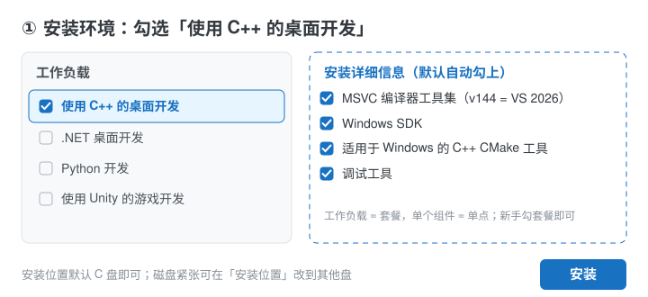
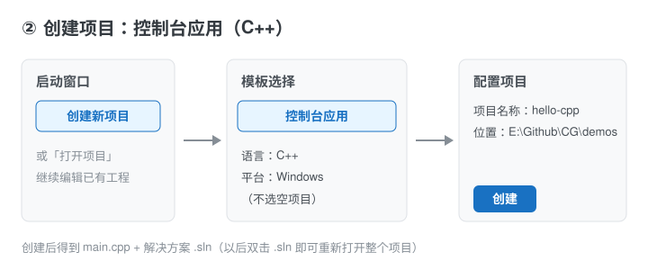
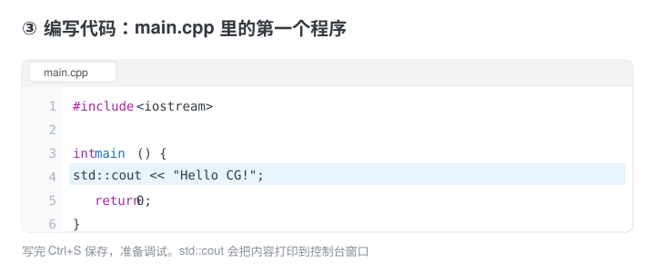
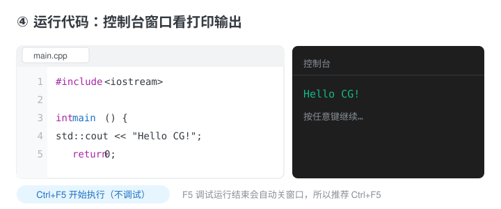
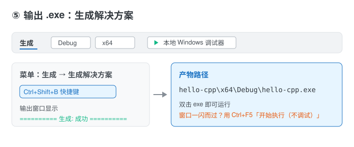
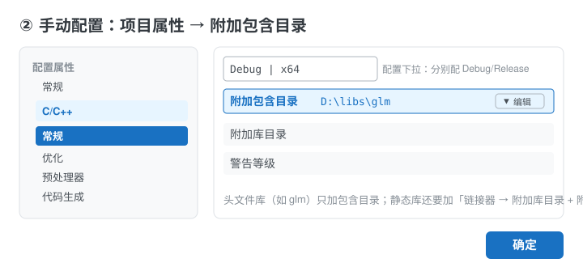

> Visual Studio 是 Windows 上的主力 C++ 开发环境 IDE，除了有点重，没啥缺点。

# Markmap 知识体系

```
Visual Studio Installer（安装管理器，本体固定 C 盘）
├── 下载: https://visualstudio.microsoft.com/zh-hans/downloads/
├── Visual Studio（IDE 集成开发环境）
│   ├── 代码编辑器
│   ├── 工程管理（.sln 解决方案 -> 记录项目全局配置 -> 启动项目入口）
│   ├── 构建系统（默认 MSbuild 构建引擎 -> 编译代码 -> .exe）
│   ├── 调试器
│   ├── Git 集成
│   └── 性能分析工具
├── Workload 工作负载（按“开发场景”打包好的一组组件集合）
│   └──  C++ 桌面开发环境
└── END
```

# FAQ 常见问题

1. 如何下载`Visual Studio Installer`？

   ::: details 查看答案
   官方下载页：https://visualstudio.microsoft.com/zh-hans/downloads/，个人/学习用免费的 **Community** 版即可。
   1. 打开下载页 → 在「下载 Visual Studio」下选 Community
   2. 运行安装器 vs_Community.exe
   3. 勾选工作负载「使用 C++ 的桌面开发」→ 安装

   :::

2. IDE 集成开发环境与 VS Code 代码编辑器有什么区别？

   ::: details 查看答案
   区别在「集成度」：IDE 把编辑、调试、构建、工程管理做成一个整体，开箱即用；代码编辑器只负责"编辑"，其余能力靠插件拼装。

   | 维度 | IDE（Visual Studio、CLion）          | 代码编辑器（VS Code）       |
   | ---- | ------------------------------------ | --------------------------- |
   | 定位 | 一站式开发环境                       | 轻量编辑器 + 插件生态       |
   | 调试 | 内置调试器，断点/单步/看内存开箱即用 | 靠扩展实现（如 C/C++ 扩展） |
   | 构建 | 内置工程系统（MSBuild / CMake 集成） | 靠插件 + 外部工具链         |
   | 体量 | 重（几 GB 起）                       | 轻（几百 MB）               |
   | 适用 | Windows 平台主力 C++/C# 开发         | 跨平台、多语言、远程/嵌入式 |

   补充：
   1. VS Code 装 C/C++ 扩展 + CMake 扩展后，同样能调 MSVC 编译、断点调试，体验接近 IDE，所以两者能力边界越来越模糊
   2. 真正的区别是「默认集成 vs 按需拼装」：IDE 拿到手就能干活，编辑器要自己搭；代价是 IDE 重、编辑器轻
   3. 两者编辑器窗口本质是同一套技术（VS 2022 起与 VS Code 共享编辑器内核），所以长得像、补全行为像

   :::

3. 如何配置 C++ 桌面开发环境？

   ::: details 查看答案
   从零到跑出第一个 `.exe` 共五步：**安装环境 → 创建项目 → 编写代码 → 运行代码 → 输出 .exe**。
   1. **① 安装环境**：运行 VS Installer，勾选工作负载「使用 C++ 的桌面开发」，右侧「安装详细信息」默认带 MSVC 工具集、Windows SDK、CMake 工具，点「安装」。安装位置默认 C 盘即可（磁盘紧张可改「安装位置」，但 Installer 本体、.NET SDK、部分 SDK/运行时仍固定在 C 盘）。

      

   2. **② 创建项目**：打开 VS →「创建新项目」→ 模板选「控制台应用」→ 填项目名称与位置 →「创建」，得到 `main.cpp` 与解决方案 `.sln`（以后双击 .sln 即可重新打开项目）。

      

   3. **③ 编写代码**：在 `main.cpp` 里写第一个程序，`std::cout` 会把内容打印到控制台窗口。

      

   4. **④ 运行代码**：`Ctrl+F5`「开始执行（不调试）」，控制台窗口看到打印输出。

      

   5. **⑤ 输出 .exe**：菜单「生成 → 生成解决方案」（Ctrl+Shift+B），产物在 `项目名\x64\Debug\项目名.exe`，双击即可运行。窗口一闪而过的话，用 Ctrl+F5「开始执行（不调试）」。

      

   :::

4. 如何引用 C++ 第三方库（如 glm）？

   ::: details 查看答案

   #### 1. **手动配置 VS 项目属性（.sln 项目）**：

   下载库源码/预编译包 → 项目右键「属性」→ 左侧 C/C++ → 常规 →「附加包含目录」填头文件路径。头文件库（如 glm）只加包含目录即可；预编译静态库还要加「链接器 → 常规 → 附加库目录」和「链接器 → 输入 → 附加依赖项」（.lib 文件名）。注意左上角「配置」下拉：Debug / Release、x86 / x64 要分别配。

   

   #### 2. 编码：

   ```C++
   #include <iostream>
   #include <glm/glm.hpp>

   int main()
   {
      glm::vec3 v1(1.0f, 2.0f, 3.0f);
      std::cout << "v1 = (" << v1.x << ", " << v1.y << ", " << v1.z << ")\n";
      return 0;
   }
   ```

   :::
