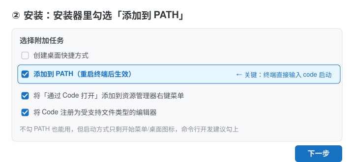
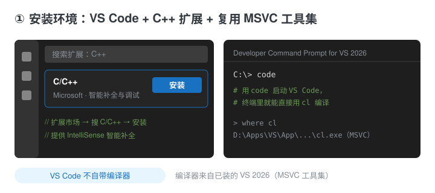
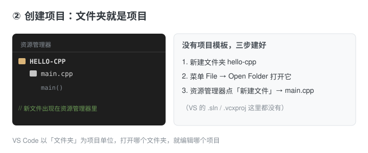
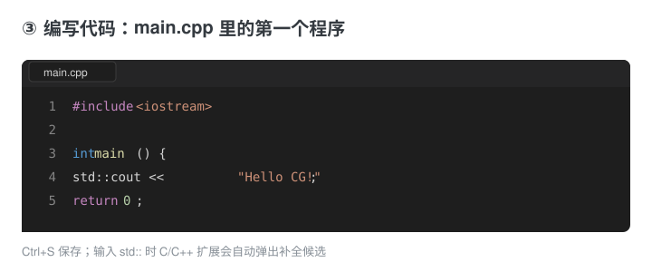
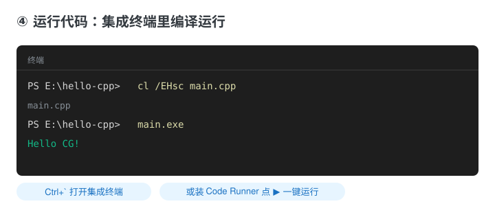
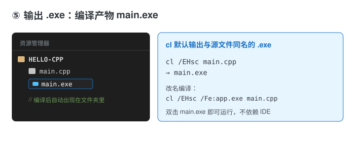

> VS Code 是轻量级的代码编辑器，自己组装插件，从而，支持各种开发环境。

# Markmap 知识体系

```
VS Code（轻量代码编辑器）
├── 安装下载: https://code.visualstudio.com/
├── 配置开发环境
│   └── C++ 开发环境
└── END
```

# FAQ 常见问题

1. 如何安装 VS Code？

   ::: details 查看答案
   1. **① 下载**：官网 https://code.visualstudio.com/ 下载 Windows 版安装包；或命令行 `winget install Microsoft.VisualStudioCode`。
   2. **② 安装**：运行安装器 → 同意协议 → 选安装位置 →「选择附加任务」勾上 **「添加到 PATH」**（重启终端后生效），其余按需——桌面快捷方式、右键菜单、注册为文件类型编辑器。

      

   3. **③ 中文界面**：装好后按 `Ctrl+Shift+X` 打开扩展市场 → 搜 Chinese (Simplified) Language Pack → 安装 → 重启生效。
      :::

2. 如何配置 C++ 开发环境？

   ::: details 查看答案
   1. **① 安装环境**：安装「Visual Studio Installer」→ 勾选工作负载「使用 C++ 的桌面开发」→ 安装 → 开始菜单「Developer Command Prompt for VS 2026」输入 `code` 启动 VS Code，终端里就能直接用本机的 MSVC 工具集（`cl`）。

      

   2. **② 创建项目**：VS Code 没有项目模板，以文件夹为单位——新建 `hello-cpp` 文件夹 → 菜单 File → Open Folder 打开 → 新建文件 `main.cpp`。

      

   3. **③ 编写代码**：在 `main.cpp` 里写第一个程序，`std::cout` 打印一行；C/C++ 扩展提供自动补全。

      

   4. **④ 运行代码**：集成终端里执行 `cl /EHsc main.cpp`编译指令，再双击`main.exe` 运行，看到打印输出。也可装 Code Runner 扩展，点 ▶ 一键编译运行。

      

   5. **⑤ 输出 .exe**：`cl` 默认在文件夹里生成与源文件同名的 `main.exe`，双击即可运行；改名用 `cl /EHsc /Fe:app.exe main.cpp`。

      

   :::
