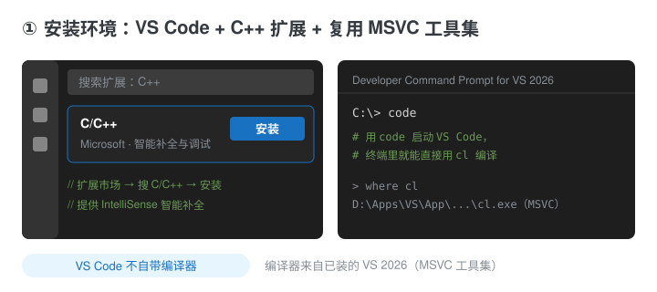
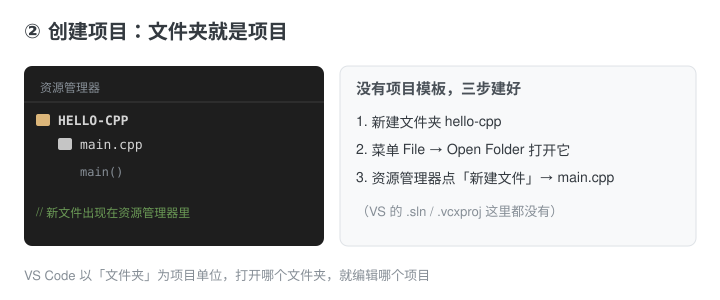
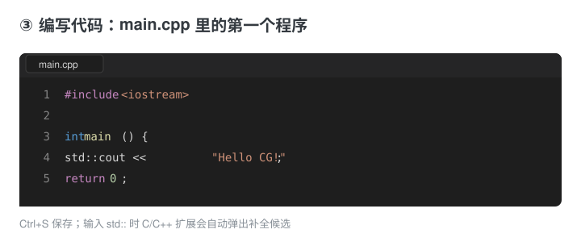
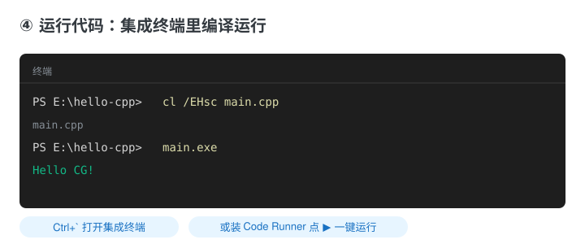
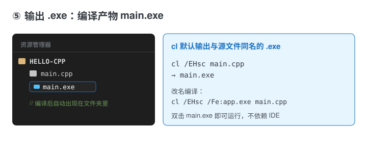

> VS Code 是轻量级的代码编辑器，自己组装插件，从而，支持各种开发环境。

# Markmap 知识体系

```
VS Code（轻量代码编辑器）
├── 下载: https://code.visualstudio.com/
├── 配置开发环境
│   └── C++ 桌面开发环境
└── END
```

# FAQ 常见问题

1. 如何配置 VS Code 的 C++ 开发环境？

   ::: details 查看答案
   1. **① 安装环境**：装 VS Code，扩展市场搜「C++」装微软官方扩展；编译器不内置——从开始菜单「Developer Command Prompt for VS 2026」输入 `code` 启动 VS Code，终端里就能直接用本机的 MSVC 工具集（`cl`）。

      

   2. **② 创建项目**：VS Code 没有项目模板，以文件夹为单位——新建 `hello-cpp` 文件夹 → 菜单 File → Open Folder 打开 → 新建文件 `main.cpp`。

      

   3. **③ 编写代码**：在 `main.cpp` 里写第一个程序，`std::cout` 打印一行；C/C++ 扩展提供自动补全。

      

   4. **④ 运行代码**：集成终端（Ctrl+`）里 `cl /EHsc main.cpp`编译，再`main.exe` 运行，看到打印输出。也可装 Code Runner 扩展，点 ▶ 一键编译运行。

      

   5. **⑤ 输出 .exe**：`cl` 默认在文件夹里生成与源文件同名的 `main.exe`，双击即可运行；改名用 `cl /EHsc /Fe:app.exe main.cpp`。

      
      :::

2. VS Code 的编译器从哪来？

   ::: details 查看答案
   VS Code 是编辑器，**不自带编译器**，二选一：
   1. **MSVC（推荐，本机已有）**：从「Developer Command Prompt for VS」启动 VS Code，终端里的 `cl` 就是 VS 那套 MSVC 工具集，编译出的程序和 VS 完全一致
   2. **MinGW-w64**：GCC 的 Windows 移植，官网或包管理器安装，配置 PATH 后用 `g++ main.cpp -o main.exe` 编译

   验证编译器是否可用：终端输入 `cl` 或 `g++ --version`，有版本输出即成功。
   :::
