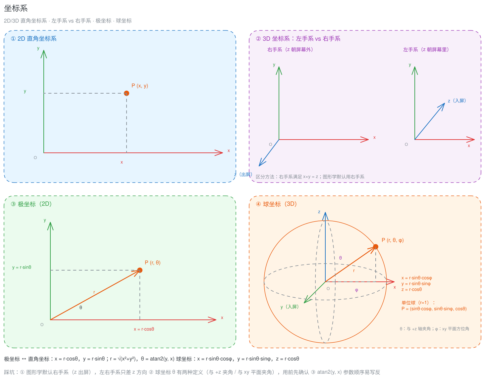

# Overview 总览

```md
坐标系/
├── 直角坐标系/
│   ├── 2D（x, y）
│   └── 3D/
│       ├── 右手系（z 朝屏幕外）
│       └── 左手系（z 朝屏幕里）
├── 极坐标（2D）/
│   ├── x = r·cosθ
│   └── y = r·sinθ
└── 球坐标（3D）/
    ├── x = r·sinθ·cosφ
    ├── y = r·sinθ·sinφ
    └── z = r·cosθ
```



# FAQ 常见问题

1. 图形学默认用左手系还是右手系？怎么区分？

   默认右手系（z 朝屏幕外）；区分方法：右手系满足 x̂ × ŷ = ẑ，左右手系只差 z 方向。

2. 极坐标和直角坐标怎么互转？

   x = r·cosθ，y = r·sinθ；反解 r = √(x²+y²)，θ = atan2(y, x)。

3. 球坐标的 θ 怎么定义？

   有两种定义（与 +z 轴夹角 / 与 xy 平面夹角），用前先确认。

4. atan2 的参数顺序是什么？

   atan2(y, x)——顺序容易写反。
