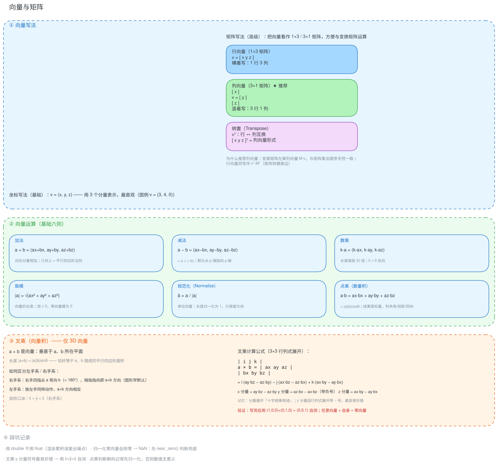

# Markmap 知识体系

```md
向量与矩阵/
├── 向量写法/
│   ├── 坐标写法 v = (x, y, z)
│   ├── 行向量（1×3）
│   └── 列向量（3×1）★推荐
├── 基础运算/
│   ├── 加法
│   ├── 减法
│   ├── 数乘
│   ├── 取模
│   ├── 规范化
│   └── 点乘
├── 叉乘（仅 3D）/
│   ├── 几何意义
│   └── 计算公式
└── 转置
```



# FAQ 常见问题

1. 为什么推荐列向量？

   变换矩阵左乘列向量 M·v，与矩阵乘法顺序天然一致；行向量则写作 vᵀ·Mᵀ（矩阵转置换边）。

2. 点乘的几何意义是什么？

   a·b = |a||b|cosθ：结果是标量，判夹角/投影/同向。

3. 叉乘的几何意义是什么？

   a × b 是垂直于 a、b 所在平面的向量；|a×b| = |a||b|sinθ 恰为两向量围成的平行四边形面积；仅 3D 向量有叉乘。

4. 怎么区分左手系/右手系的叉乘方向？

   右手系：右手四指从 a 弯向 b（< 180°），拇指指向即 a×b 方向；左手系按左手同样动作，方向相反。自检口诀：x̂ × ŷ = ẑ。

5. 叉乘 y 分量为什么容易抄错？怎么自测？

   行列式展开带 − 号；写完后用 (1,0,0)×(0,1,0) = (0,0,1) 自测。

6. 归一化零向量会怎样？

   除零 → NaN：先 near_zero() 判断兜底。

7. 点乘判朝向要注意什么？

   先归一化，否则数值无意义。

8. 向量计算用 float 还是 double？

   double：float 渲染累积误差出噪点。
