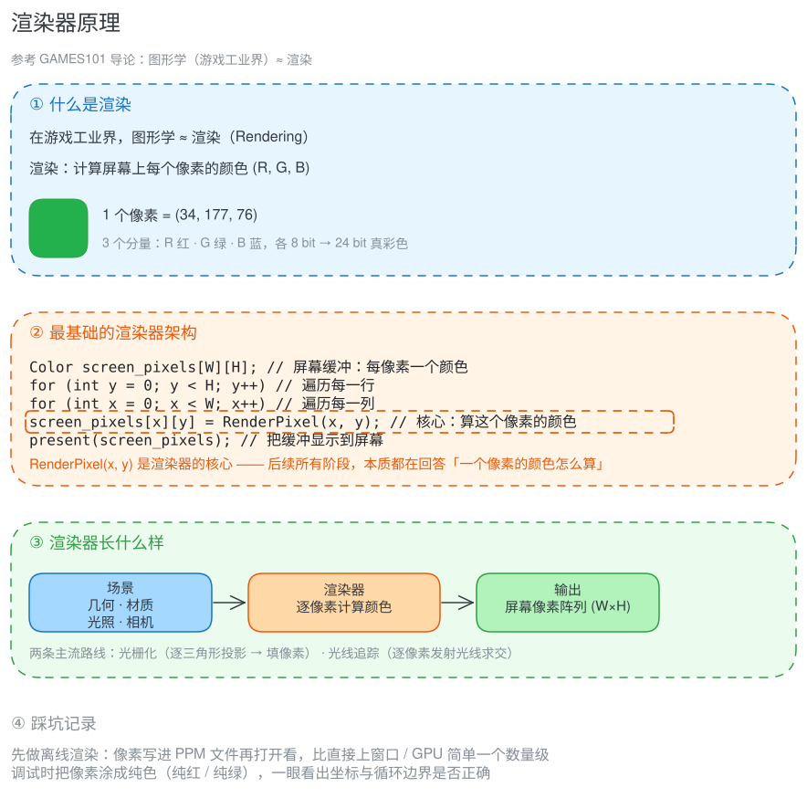

# Markmap 知识体系

```md
渲染器/
├── 什么是渲染/
│   └── 计算每个像素的 RGB
├── 最小架构/
│   ├── 屏幕缓冲 screen_pixels[W][H]
│   ├── 双重循环（x, y）
│   ├── RenderPixel(x, y)
│   └── present
├── 完整形态/
│   ├── 场景（几何 · 材质）
│   ├── 光照
│   ├── 相机
│   └── 输出屏幕像素阵列
└── 两条路线/
    ├── 光栅化
    └── 光线追踪
```



# FAQ 常见问题

1. 渲染的本质是什么？

   计算屏幕上每个像素的颜色 (R, G, B)，各 8 bit → 24 bit 真彩色；在游戏工业界，图形学 ≈ 渲染。

2. 渲染器最核心的函数是什么？

   RenderPixel(x, y)：后续所有阶段，本质都在回答「一个像素的颜色怎么算」。

3. 光栅化和光线追踪的区别是什么？

   光栅化：逐三角形投影 → 填像素；光线追踪：逐像素发射光线求交。

4. 新手先做离线还是实时渲染？

   先做离线渲染：像素写进 PPM 文件再打开看，比直接上窗口/GPU 简单一个数量级。

5. 怎么调试坐标与循环边界？

   把像素涂成纯色（纯红/纯绿），一眼看出坐标与循环边界是否正确。
